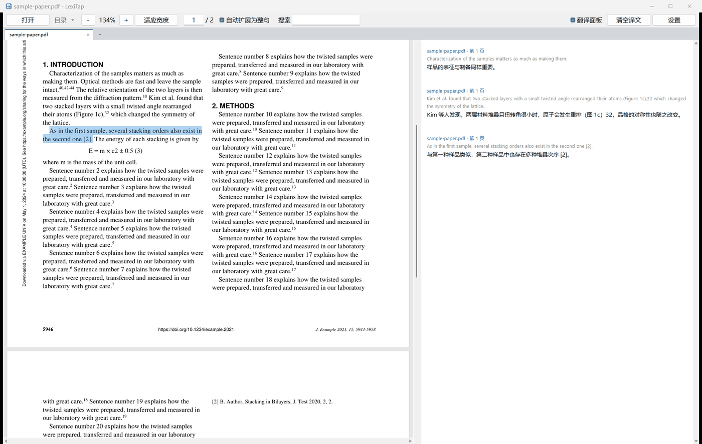

# LexiTap

轻量的 PDF 阅读器，为读外文论文而做：打开右侧的翻译面板，用鼠标划选文字（可以跨行、跨栏、跨页），松开后选区自动扩展成完整的句子，译文流式显示在面板里。翻译默认使用 DeepSeek，也可以换成任何兼容 OpenAI 接口的大模型服务。

整个程序只有一个 Python 文件（`lexitap.py`），只依赖 PyMuPDF。



## 下载安装

到 [Releases 页面](../../releases/latest) 下载对应系统的安装包：

| 系统 | 安装包 | 安装方法 |
| --- | --- | --- |
| Windows 10、11 | `lexitap-<版本>-windows-x64-setup.exe` | 双击运行，见下文 [Windows 安装程序](#windows-安装程序) |
| Windows 免安装版 | `lexitap-<版本>-windows-x64.zip` | 解压到任意位置，运行 `LexiTap.exe` |
| macOS | `lexitap-<版本>-macos-arm64.dmg`（Apple 芯片）、`…-macos-x64.dmg`（Intel） | 打开后把应用拖进“应用程序” |
| Debian、Ubuntu、Mint 等 | `lexitap_<版本>_amd64.deb` | `sudo apt install ./lexitap_<版本>_amd64.deb`，会添加菜单项、`lexitap` 命令和 PDF 的“打开方式” |
| 其他 Linux | `lexitap-<版本>-linux-x64.tar.xz` | 解压后运行 `lexitap/lexitap` |
| 装有 Python 3.9 以上的任何系统 | `lexitap-<版本>-py3-none-any.whl` | `pip install lexitap-<版本>-py3-none-any.whl`，然后运行 `lexitap`。Linux 上 Tk 要另装：`sudo apt install python3-tk` |

说明：

- **设为默认的 PDF 程序。** 各个系统都把这个选择留给用户。Windows 上安装后，下次双击 PDF 时系统会询问用哪个程序打开，选 LexiTap 并点“始终”即可；之后也可以随时右键 PDF →“打开方式”→“选择其他应用”。macOS 和 Linux 在文件管理器的“打开方式”里设置。
- 程序运行时再打开 PDF，会在已有的窗口里新开一个标签页。
- macOS 安装包没有签名，第一次启动会被拦截：到“系统设置 → 隐私与安全性”点“仍要打开”，或执行 `xattr -dr com.apple.quarantine /Applications/LexiTap.app`。

### Windows 安装程序

- 只为当前用户安装，不需要管理员权限，安装位置可以自己选。它会添加开始菜单项（勾选后还有桌面快捷方式），并把程序列入 PDF 的“打开方式”。（`setup.exe /ALLUSERS` 为所有用户安装，这时才需要管理员权限。）
- **升级：** 直接运行新版安装程序，设置会保留。程序还开着的话，会先提示你关闭。
- **卸载：** “设置 → 应用 → 已安装的应用”。你的设置和译文缓存留在 `%APPDATA%\lexitap`，想一并清除就删掉这个文件夹。
- **静默安装：** `setup.exe /VERYSILENT /SUPPRESSMSGBOXES`。
- **安全提示。** 安装包自带 Python 和全部依赖库，目标电脑上什么都不用预装。安装程序目前没有代码签名，所以用浏览器下载后第一次运行时，Windows SmartScreen 会显示“Windows 已保护你的电脑”，点“更多信息 → 仍要运行”即可；有些杀毒软件也会询问。用 U 盘或共享文件夹拷到电脑上再运行，则没有这个提示。只有代码签名证书能去掉它（证书由签发机构核实身份后付费签发）；有证书时，构建脚本会给程序和安装包签名，见[在自己的电脑上构建](#在自己的电脑上构建)。

## 从源码运行

需要 Python 3.9 以上（自带 Tk），再装一个依赖（PyMuPDF 2 也能用，但下载体积是 1.x 的三倍）：

```bash
pip install -U "pymupdf<2"
```

- Windows：双击 `run.bat`，或把一个或多个 PDF 拖到它上面（每个文件开一个标签页）。
- 任何系统：`python lexitap.py paper.pdf other.pdf`

## 设置与数据

第一次翻译时会弹出**设置**对话框，粘贴 API Key 后点**保存**。

程序把设置存在 `config.json`（里面有你的 API Key，不要外传），把翻译过的句子存在 `translations.json`，上次打开的标签页也记在 `config.json` 里。这两个文件放在同一个文件夹：

- 如果程序所在的文件夹里已经有 `config.json`，就用那个文件夹（便携用法，比如和 `lexitap.py` 或 `.exe` 放在一起）；
- 否则用用户目录：Windows 为 `%APPDATA%\lexitap`，macOS 为 `~/Library/Application Support/lexitap`，Linux 为 `~/.config/lexitap`；
- 设置了环境变量 `LEXITAP_HOME` 时，用它指定的文件夹。

想把设置带到安装版，把 `config.json` 和 `translations.json` 复制到上面的用户目录即可。每个设置文件夹对应一个窗口，所以便携版和安装版可以同时运行。

## 使用方法

启动时翻译面板是关闭的，PDF 占满整个窗口，这时 LexiTap 就是一个普通的 PDF 阅读器。要翻译，先打开面板。

| 操作 | 作用 |
| --- | --- |
| 勾选“翻译面板”，或 Ctrl + T | 打开右侧的翻译面板。页面会重新适应面板左边剩下的宽度，整页宽度始终可见（即使之前放大过） |
| 在文字上拖动 | 选中文字，可以跨行、跨栏、跨页；拖到窗口上下边缘之外会自动滚动。松开后选区扩展成完整的句子并翻译 |
| 双击某个词 | 翻译它所在的句子 |
| → / ← | 选中并翻译下一句 / 上一句（没有选区时从当前页面顶部开始），适合逐句精读 |
| Shift + 单击 | 把上一次的选区延伸到这里（适合选很长的一段） |
| Ctrl + C | 复制选中的文字，PDF 里和译文面板里都可以 |
| Ctrl + F，或“搜索”框 | 输入词或短语后按回车跳到匹配处。视野内页面上的匹配会加橙色边框，当前这一个更粗。回车 / Shift + 回车，或 F3 / Shift + F3，跳到下一个 / 上一个；在搜索框里按 Esc 结束搜索 |
| 鼠标停在引用编号、图表或章节的引用上 | 稍等片刻弹出预览：参考文献列表里的那一条，或链接指向的页面。网页链接显示网址 |
| 单击这类链接 | 跳转过去（网页链接用浏览器打开），Alt + ← 返回 |
| 单击译文上方的“文件名 · 第 N 页” | 回到 PDF 里的原文处，文件已关闭时会重新打开 |
| 取消勾选“自动扩展为整句” | 只翻译选中的内容（一个词或短语），不扩展成整句 |
| 取消勾选“翻译面板”，或再按 Ctrl + T | 关闭面板，页面重新占满窗口宽度。面板关闭时划选只是选中，不扩展也不翻译 |
| 滚轮 / PageUp / PageDown / Home / End | 滚动 |
| Ctrl + 滚轮，或 － ＋ | 缩放；“适应宽度”让页面宽度贴合窗口 |
| 页码框、“目录” | 跳到某一页，或打开目录 |
| 标签栏上的 ＋、“打开”，或 Ctrl + O | 打开 PDF（可以一次选多个），每个文件一个标签页。已经打开的文件只切换到它的标签页 |
| 单击标签页，Ctrl + Tab / Ctrl + Shift + Tab，Ctrl + PageUp / PageDown | 在打开的 PDF 之间切换 |
| 标签页上的 ×、中键单击标签页，或 Ctrl + W | 关闭这个 PDF |

和浏览器一样，每个标签页各自记住页面位置、缩放和选区；下次启动时，程序会在原来的位置重新打开这些标签页。译文面板为所有标签页共用，按先后顺序列出你翻译过的内容，每条上方标着来源文件和页码。

## 翻译质量

- **术语统一。** 每次请求都会告诉模型这段文字出自哪篇论文（PDF 里存的标题，没有就取第一页上最大的文字），并要求使用该领域的规范译名。
- **术语表。** 在“设置 → 术语表”里每行写一条，例如 `moiré superlattice = 莫尔超晶格`（`=`、`:`、`→` 都可以）。选中的文字包含某个术语时，会要求模型采用你的译法。只发送出现在选区里的术语。
- **公式。** 独立成行的公式以 `[公式]` 代替后发送，因为从 PDF 里提取出的公式文字通常是乱的，只会干扰模型。
- **记忆。** 译文保存在磁盘上（最近的 3000 条）。翻译过的句子再次选中时立即显示，重启后也一样，不再调用 API。更换模型、提示词或术语表后会重新翻译。

## 选区为什么只落在正文上

PDF 本身没有阅读顺序，文字是一块块带坐标的片段。期刊 PDF 常把图注、标题、关键词、脚注、页眉横幅、页边水印存放在两段正文之间，照存储顺序选下去就会跳进这些内容里。

所以程序给每个文字块定一个类别，由文字方向、主要字体、主要字号和种类组成。种类有：

- “页边”：整块位于页面外侧 8% 的范围内（页眉、页脚、页码、侧边水印）。
- “图注”：以 `Figure 2.`、`Fig. 3:`、`Table 1` 这样的标签开头。被 PDF 拆成几块存放的图注仍算一个整体：紧挨在它下方、字体字号相同的块属于它。
- “注释”：位于页面下部，开头像脚注（`*`、`†`、E-mail、DOI 链接、Received、© 等）。
- “插入框”：打断了文字流。正文顺着一栏往下排，或接到右边一栏；存储位置在后、版面位置却在上方的小块（比如期刊横幅）就是插进来的框。
- “正文”：其余所有文字。

MuPDF 有时会在公式、重音符号或上下标处，把视觉上的一行拆成几块（例如 E⃗₁(2ω) 周围）。和较大的块同在一行、与它相接或落在它轮廓之内的短块，并入较大的块。这样句子或图注里的公式会一起选中，不会留下空洞。画出来的箭头和花括号的碎片（`⎯`）不计入提取的文字。

选区和它的整句扩展只取同一类别的文字，再加上这类文字的小标题：

- 拖动时保持起点所在的类别，终点落在这类文字里最近的词上，所以拖过图注末尾会停在图注的最后一行。例外是从小块（标题、图中的标签）开始拖动：这时取终点所在的类别，因此从标题拖进下面的段落，会连标题一起选中。
- 正文会越过其他一切内容连续读下去，可以跨栏、跨页。
- 选区内的小节标题会保留，各自成段。这里的标题指这样的短块：
  - 紧挨在文字上方，且在同一栏内；
  - 字号不比正文小很多；
  - 大部分是字母，不以小写字母开头，不以句号结尾；
  - 没有使用图注的字体；
  - 在相邻页面的同一位置没有重复出现（页眉和徽标会重复）。

  所以公式、代码行和零散的图注碎片不会被当成标题。
- 从图注、标题、关键词、页脚（比如想复制 DOI）或水印开始选，选区就留在那段文字里。

## 段落和句子怎么判定

- 新段落开始于：
  - 标题处；
  - 首行缩进处；
  - 项目符号处；
  - 一个句子结束在短行上，或它后面有额外的空白时。

  同一行上的上下标不会开始新段落。图注、表注始终算一个段落。
- 句子在 `. ! ? 。 ！ ？` 处结束，句号后紧跟引用编号时也算（`stacking.18`、`bonds.[13–15]`、`ways.40,42−44`）。句子不会越过段落末尾。
- 缩写（e.g.、i.e.、et al.、Fig.、Eq. 等）、姓名首字母、`2.1` 这样的小数，以及后面跟着小写单词的句点，都不算句子结束。
- 行末被连字符断开的单词会接回去（“trans- lation” → “translation”）。

译文面板按段落显示：

- 每段原文后面跟着它的译文。
- 选区有多个段落时，各段之间以空行分隔后发送，并要求模型保持同样的分段。如果模型仍然合并或拆分了段落，面板先显示全部原文，再显示整段译文。
- 面板文字两端对齐。换行只发生在汉字之间或空格处，不会出现在 `，`、`。` 这类标点之前。
- 从面板复制得到的文字保留分段，但不含为排版加入的换行。

## 换用其他大模型服务

任何提供 OpenAI 兼容 `/chat/completions` 接口的服务都可以用。在“设置”里选择或填写 API 地址，再填入 API Key 和服务商控制台里的模型名：

| 服务商 | API 地址 |
| --- | --- |
| DeepSeek（默认） | `https://api.deepseek.com`（模型 `deepseek-flash` 或 `deepseek-v4-pro`） |
| 通义千问（DashScope） | `https://dashscope.aliyuncs.com/compatible-mode/v1` |
| Kimi（Moonshot） | `https://api.moonshot.cn/v1` |
| 智谱 GLM | `https://open.bigmodel.cn/api/paas/v4` |
| 硅基流动 SiliconFlow | `https://api.siliconflow.cn/v1` |
| OpenAI | `https://api.openai.com/v1` |
| Ollama（本地，无需 Key） | `http://localhost:11434/v1` |

说明：

- DeepSeek 的模型默认先“思考”再回答，翻译会变慢。对 `api.deepseek.com`，程序自动发送 `"thinking": {"type": "disabled"}`。
- `config.json` 里的 `"extra"` 会并入每次请求的请求体，用来设置服务商特有的选项，例如 `"extra": {"temperature": 1.3}`。
- 目标语言和文风可以在“提示词”（系统提示词）里改。
- 系统设置了代理时，程序先不经代理直接访问 API，国内的服务这样快好几倍。直连不通，或服务因为所在地区拒绝请求（HTTP 400、403、451）时，再走代理。

## 已知限制

- 没有文字层的扫描版 PDF 无法选字，请先做 OCR（例如用 `ocrmypdf`）。
- 断句规则针对用空格分词的语言（英语、法语、德语等）。中文、日文 PDF 只能整行整行地选。
- 正文按 PDF 的存储顺序读取。绝大多数期刊 PDF 的顺序是对的，制作粗糙的 PDF 仍可能跳来跳去。
- 图或表里的文字如果字体字号和正文完全一样，会被当作正文，可能混进穿过它的选区。
- 独立公式靠外形识别：只有几行短行，且大部分是符号。行内公式按提取结果原样发送，可能是乱的。在某些版式里，公式后面接着写的句子（“…can be written as [公式] where …”）会在公式处断开。
- 带 OCR 文字层的扫描版 PDF，各行字号可能不一致。与相邻行字号相差 7% 以上的行会被当作另一类文字而跳过。
- 链接预览和跳转依赖 PDF 里存的链接。多数期刊 PDF 有，没有链接的 PDF（很多预印本）就没有预览。

## 更新与发布

代码推送到 GitHub 的 `main` 分支后，[GitHub Actions](.github/workflows/build.yml) 会自动：

1. 在 Windows、macOS、Linux 上运行测试；
2. 构建全部安装包（Windows 安装程序和 zip、macOS 磁盘映像、Linux 的 `.deb` 和 `.tar.xz`、pip 包），在各自的系统上安装并启动一次，然后保存在这次运行的 Artifacts 里；
3. 如果 `lexitap.py` 顶部的版本号 `__version__` 还没有对应的 Release，就创建名为 `v<版本号>` 的 Release 并附上这些安装包。

所以：

- **日常更新：** 改完代码，提交并推送。
- **发布新版本：** 把 `lexitap.py` 里的 `__version__` 改成新的版本号，提交并推送。几分钟后新版本就出现在 Releases 页面。

### 在自己的电脑上构建

PyInstaller 只能为它所在的系统构建：

```bash
pip install "pymupdf<2" pyinstaller pillow
python packaging/build.py
```

安装包生成在 `dist/`。Windows 上构建安装程序还需要 [Inno Setup 6](https://jrsoftware.org/isinfo.php)（免费，装在哪里都行），没有它只生成 zip。要给程序和安装包签名，把环境变量 `LEXITAP_SIGN` 设为签名命令，用 `$f` 代表文件，例如 `signtool sign /a /fd sha256 /tr http://timestamp.digicert.com /td sha256 $f`。Linux 上生成 `.deb` 需要 `dpkg-deb`（Debian、Ubuntu 自带）。pip 包用 `pip wheel . --no-deps -w dist` 生成。

## 测试

```bash
python tests/test_reader.py
```

测试会自己生成 PDF，和本机上的模拟翻译接口通信，并使用临时的设置文件夹，不会动你自己的设置和译文。它会打开真实的窗口，检查断句和分段、页面绘制、文字类别、发给模型的请求（有无系统代理两种情况）、译文面板、搜索、链接、标签页、会话恢复，以及把文件交给已运行窗口的过程。有失败项时输出 FAIL，并以退出码 1 结束。在没有显示器的 Linux 机器上用 `xvfb-run -a python tests/test_reader.py`。

## 许可

LexiTap 以 [GNU AGPL-3.0](LICENSE) 许可发布。它使用的 [PyMuPDF](https://pymupdf.readthedocs.io/) 同样采用 AGPL-3.0（另有商业许可）。
